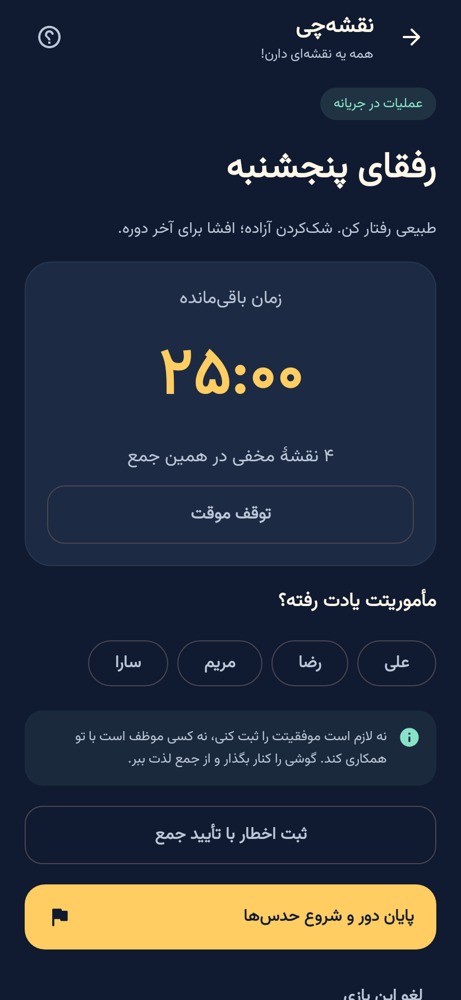

<div align="center">


<br />

[](https://github.com/maboox/Planer/actions/workflows/android.yml)


### یک گوشی، یک جمع، چند نقشهٔ مخفی.

مأموریتت را بگیر، طبیعی رفتار کن؛ آخر دور معلوم می‌شود هرکس چه نقشه‌ای داشته.

<p>
<a href="https://github.com/maboox/Planer/releases/download/preview/naghshechi-preview.apk"></a>
<a href="docs/GAME_RULES.fa.md"></a>
<a href="https://github.com/maboox/Planer/issues/new/choose"></a>
</p>

**نسخهٔ اولیهٔ قابل‌آزمایش؛ آمادهٔ انتشار عمومی بازار محسوب نمی‌شود.**

</div>

## تجربهٔ بازی

۱. جمع ۴ تا ۱۲ نفره را بساز؛ اسم‌ها و تنظیمات برای دفعهٔ بعد ذخیره می‌شوند.  
۲. فضای خانوادگی، دوستانه یا کاری، سطح ساده/متوسط/سخت و سبک‌ها را انتخاب کن.  
۳. گوشی را بچرخان؛ هرکس فقط مأموریت خودش را می‌بیند.  
۴. گوشی کنار می‌رود؛ هرکس در جریان مهمانی نقشه‌اش را اجرا می‌کند.  
۵. پیش از اولین افشا، هر نفر حداکثر دو هدف حدس امتیازی انتخاب می‌کند.  
۶. کارت‌های کامل رو می‌شوند؛ حدس‌ها و اجرای مأموریت داوری و امتیاز ثبت می‌شود.

## چیزهایی که داخلشه

| تجربه | جزئیات |
|---|---|
| مأموریت‌های متنوع | ۶۰ خانوادهٔ تألیفی، ۱۸۰ کارت در سه سطح؛ سطح‌ها محتوای مستقل حساب نمی‌شوند |
| سبک‌های مختلف | گفت‌وگو، اقدام، همکاری، خلاقیت، مذاکره و اجرا |
| مرزهای روشن | امکانات و محدودیت‌ها قبل از بازی؛ هر کارت دارای شرط موفقیت و موارد نامعتبر |
| بازی آفلاین | بدون حساب یا سرور اختصاصی؛ اینترنت فقط برای AI اختیاری |
| سابقهٔ جمع | جدول همان دور، بردها، نشان‌ها و بازدید مأموریت‌های قبلی |
| ادامهٔ بازی | ذخیرهٔ مرحله، مأموریت‌ها و زمان؛ بدون قرعه‌کشی مجدد |
| پشتیبان دستی | خروجی و بازیابی محلی؛ بدون کلید API و بازی نیمه‌تمام |
| حریم خصوصی | بدون دوربین، میکروفون، مخاطبان، مکان، تبلیغات یا تحلیل رفتار |

## نماهای واقعی اپ

تصاویر این بخش از اجرای رابط اندروید در آزمون تصویری تولید می‌شوند؛ تصویر مفهومی نیستند.

<p align="center">
  
  
  
</p>
<p align="center">
  
  
  
</p>

## AI با کلید خودت

در تنظیمات، کلید شخصی AvalAI و شناسهٔ مدل سازگار با JSON را وارد کن. کلید در کد و فایل APK نیست و با حفاظت متکی بر Android Keystore روی دستگاه ذخیره می‌شود. اسم واقعی و جایزه ارسال نمی‌شوند؛ فقط تنظیمات لازم و نشان کودک ارسال می‌شود. دادهٔ بدون اسم لزوماً ناشناس کامل نیست.

خروجی AI قبل از ذخیره از نظر ساختار، امکانات و تناسب بررسی می‌شود، ولی کیفیت و رعایت معنایی تمام محدودیت‌ها تضمین خودکار ندارد. هر بازیکن پیش از شروع یک تعویض دارد. بدون کلید، اعتبار یا اتصال هم بسته‌های محلی قابل‌بازی‌اند.

## ساخت و دریافت APK

```bash
./gradlew testDebugUnitTest lintDebug lintRelease assembleDebug
```

پیش‌نیازها: JDK 17، Android SDK 36 و دسترسی به Google Maven و Maven Central. Gradle Wrapper با checksum در مخزن است.

با هر پوش روی `main`، GitHub Actions تست، بررسی اندروید و ساخت را اجرا می‌کند. پس از موفقیت، APK در بخش **Actions → naghshechi-preview** و صفحهٔ **Releases → preview** قرار می‌گیرد. بستهٔ آزمایشی شناسهٔ جدا و امضای توسعه دارد؛ تغییر امضای ساخت‌های آزمایشی ممکن است نیاز به حذف و نصب مجدد داشته باشد. پیش از آن پشتیبان بگیر.

نسخهٔ انتشار با تگ `v*` فقط پس از تنظیم کلید امضای خصوصی ساخته می‌شود. [راهنمای انتشار](docs/BUILDING.md)

## داخل پروژه

```text
app/src/main/java/ir/naghshechi/app/
├── game/       قواعد، مدل‌ها، زمان و امتیاز
├── data/       Room، تنظیمات، کلید و AvalAI
├── ui/         رابط فارسی Compose
└── GameViewModel.kt
app/src/main/assets/missions.json
app/src/test/   تست قواعد، حریم خصوصی و جریان رابط
.github/        ساخت خودکار و قالب گزارش مشکل
docs/           قواعد، حریم خصوصی و راهنمای توسعه
```

## بیشتر بخوان

[قواعد بازی](docs/GAME_RULES.fa.md) · [حریم خصوصی](docs/PRIVACY.fa.md) · [ساخت و انتشار](docs/BUILDING.md) · [امنیت](SECURITY.md) · [مجوز اجزای استفاده‌شده](THIRD_PARTY_NOTICES.md)

[گزارش بررسی نسخه و محدودیت‌های تست](docs/VERIFICATION.md) · [تغییرات](CHANGELOG.md)

قواعد و امتیازهای این نسخه باید با جمع واقعی آزمایش شوند؛ تست نرم‌افزاری جای تجربهٔ مهمانی را نمی‌گیرد.
